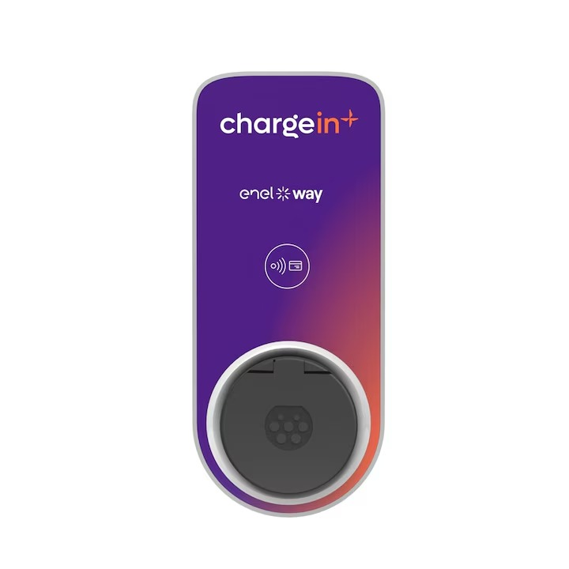

# Endesa X / Enel X JuiceBox & Victron ESS Integration for Home Assistant

[](https://hacs.xyz)
[](https://www.home-assistant.io)
[](LICENSE)
[](https://my.home-assistant.io/redirect/hacs_repository/?owner=relust&repository=ha-endesa-juicebox&category=integration)

<p align="center">
  
  <br>
  <em>Endesa X / Enel X JuiceBox (Waybox EU) 7.4 kW / 22 kW EV Charger</em>
</p>

A high-performance, **100% local Home Assistant custom integration** for **Endesa X / Enel X JuiceBox (Waybox EU)** EV chargers with native solar surplus tracking and direct hardware synchronization with **Victron Energy (Cerbo GX / MultiPlus-II ESS)** systems.

---

## The Background Story: Cloud Shutdown & Hardware Reality

### 1. The Enel X Cloud Shutdown & Local Liberation
In late 2024, Enel X Way abruptly announced the complete shutdown of its North American software operations and the discontinuation of the JuiceNet cloud services, leaving tens of thousands of smart EV chargers crippled without remote access or scheduling. In Europe, the legacy JuicePass and Enel X Way mobile applications have been plagued with severe instability, sluggish cloud response times, and ongoing deprecation.

This integration was created to **liberate the charger completely**:
* **Zero cloud reliance:** Operates entirely within your local home network (LAN).
* **Future-proof:** Your charger will continue working indefinitely, even if external vendor servers go dark permanently.
* **Instant response:** Commands and telemetry execute locally with sub-second latency instead of traveling through remote cloud APIs.

### 2. European Waybox EU vs. US / Canada Models (Crucial Hardware Difference)
There is widespread confusion on online forums where users assume all "JuiceBox" units share the same internal hardware. **They do not:**

* **North American Models (US / Canada):** Built around basic 8-bit or 32-bit microcontrollers (such as ESP8266 or PIC) running proprietary JuiceNet firmware. When the cloud server was shut down, these units lost smart capabilities entirely unless retrofitted with custom hardware boards (e.g., OpenEVSE or custom ESP modules).
* **European Models (Endesa X Waybox / Enel X JuiceBox Pro 3.01 / Plus / Cellular):** These units are built like industrial power controllers. Under the hood, they run a **full embedded Linux operating system (ARM architecture)** equipped with:
  - An internal web server (**Lighttpd & PHP**) on ports 80 and 443.
  - Native internal daemons managing **Modbus RTU** communication with the certified MID energy meter and IEC 61851 Control Pilot board.
  - A local **WebSocket server** for live engineering control.

Because the European units run embedded Linux, **no hardware modification or disassembly is required**. This integration connects directly to the charger's local web and WebSocket daemons over Wi-Fi or Ethernet, writing live current limits directly into memory and reading certified MID metering data in real time!

---

## Key Features

- **100% Local Control (No Cloud Required):** Communicates directly with the charger over local HTTP and WebSocket.
- **Sub-Second Dynamic Current Modulation (6A – 32A):** Live current changes are written directly into microcontroller RAM via WebSocket in under 500ms without restarting the charging session or the station.
- **Intelligent Solar Surplus Charging (Auto Mode):** Dynamically adjusts the EV charging rate in 1A increments based on available photovoltaic surplus, prioritizing the home storage battery according to a user-defined minimum SoC threshold (e.g., 60%).
- **Direct Victron Cerbo GX Hardware Link (Modbus TCP):** Direct asynchronous communication with Cerbo GX on port 502 reads real-time solar production, home battery SoC, AC consumption, and grid exchange in under 20ms. Completely decoupled from third-party integrations with **zero duplicate entities** in Home Assistant.
- **Inverter Overload & Off-Grid Protection:** Automatically throttles charging or pauses the EV if a grid failure occurs or if total inverter demand exceeds safe continuous limits (e.g., 4500W limit on MultiPlus-II 5000).
- **Smart Plug & Charge with Anti-Flapping:** Automatic physical cable detection with a 12-second debounce filter prevents spurious auto-start events caused by brief Wi-Fi packet drops.
- **Comprehensive Energy & Power Telemetry:** Full measurement of Active Power (W), Line Current (A), Voltage (V), and Session / Lifetime Energy (kWh) fully compatible with the Home Assistant Energy Dashboard.
- **Dynamic EV Telematics Estimation:** Real-time state-of-charge (%) and added range calculation for electric vehicles (pre-configured for Nissan Leaf 62 kWh, adaptable to any EV).

---

## Architecture Overview

```
 ┌──────────────────────┐                     ┌──────────────────────────────┐
 │   Endesa X JuiceBox  │ <── HTTP / WS ────> │   Home Assistant             │
 │   (192.168.0.173)    │                     │   custom_components/         │
 └──────────────────────┘                     │   endesa_juicebox            │
                                              └──────────────┬───────────────┘
                                                             │
                  ┌──────────────────────────────────────────┴─────────────────────────┐
                  │ Direct Modbus TCP (Port 502)             │ Virtual EVCS via MQTT   │
                  ▼                                          ▼                         │
 ┌──────────────────────────────────┐       ┌──────────────────────────────────────────┴┐
 │   Victron Cerbo GX (Venus OS)    │ <───> │  dbus-mqtt-ev-charger driver              │
 │   192.168.0.135:502 / 1883       │       │  (Native EVCS UI on Touch 50/70 & VRM)    │
 └──────────────────────────────────┘       └───────────────────────────────────────────┘
```

---

## Installation via HACS

### Option 1: 1-Click Install via My Home Assistant
Click the button below to add this repository directly to your Home Assistant Community Store:

[](https://my.home-assistant.io/redirect/hacs_repository/?owner=relust&repository=ha-endesa-juicebox&category=integration)

### Option 2: Add as a Custom Repository
1. In Home Assistant, open **HACS**.
2. Navigate to **Integrations**.
3. Click the three dots in the top right corner and select **Custom repositories**.
4. Paste the repository URL:
   ```
   https://github.com/relust/ha-endesa-juicebox
   ```
5. Set the **Category** to **Integration**.
6. Click **Add**, locate **Endesa X JuiceBox & Victron ESS**, and click **Download**.
7. Restart Home Assistant.

---

## Configuration

1. In Home Assistant, navigate to **Settings** > **Devices & Services** > **Add Integration**.
2. Search for **Endesa X JuiceBox**.
3. Enter the device parameters:
   - **Host:** IP address of the JuiceBox charger on your local network (e.g., `192.168.0.173`).
   - **Password:** Web Manager administrator password (factory default is `000000`).
   - **Auto-Start on Plug-in:** Enable automatic charging on physical cable connection (Plug & Charge).
   - **Enable Victron MQTT:** Publish virtual EV charger topics for Venus OS.
   - **Victron Topic:** Base MQTT topic (default: `venus-os/evcharger`).

---

## Exposed Entities & Controls

### Sensors
- `sensor.juicebox_power` — Active charging power (W)
- `sensor.juicebox_current_l1` — Real-time AC current (A)
- `sensor.juicebox_voltage_l1` — Grid voltage (V)
- `sensor.juicebox_energy` — Lifetime accumulated energy (kWh)
- `sensor.juicebox_session_energy` — Energy delivered during the current session (kWh)
- `sensor.juicebox_status` — Charger operating state (`Disconnected`, `Standby`, `Charging`)
- `sensor.juicebox_solar_surplus` — Live calculated solar surplus power (W)
- `sensor.juicebox_solar_status` — Human-readable solar regulation engine state
- `sensor.juicebox_leaf_estimated_battery` — Live estimated vehicle battery level (%)
- `sensor.juicebox_leaf_estimated_range` — Live estimated remaining range (km)

### Binary Sensors
- `binary_sensor.juicebox_vehicle_connected` — IEC 61851 Control Pilot vehicle connection state

### Numbers (Controls)
- `number.juicebox_charging_current` — User charging current setpoint (6A to 32A)
- `number.juicebox_solar_min_battery_soc` — Minimum house battery SoC required before allocating surplus to EV (20% – 100%, default 60%)
- `number.juicebox_solar_cloud_tolerance` — Cloud tolerance grace period before pausing charge (1 – 15 minutes, default 3 min)

### Switches
- `switch.juicebox_charging` — Manual start / pause charging switch (with vehicle-connection safety guard)
- `switch.juicebox_auto_start` — Enable / disable automatic charging on physical cable connect

---

## Victron Venus OS (Cerbo GX) Integration

The integration includes complete support for Victron Energy ESS systems:

1. **Direct Modbus TCP Link:** Reads PV power, consumption, grid, and inverter overload alarms directly from the Cerbo GX (`192.168.0.135:502`) without creating extra entities in Home Assistant.
2. **Virtual EV Charger on D-Bus:** Exposes the station natively in Victron Touch 50/70, GUI-v2, and VRM Portal via the `dbus-mqtt-ev-charger` service.
3. **Step-by-step setup guide and sample configuration:** See the dedicated [`victron/`](victron/) folder in this repository for full instructions.

---

## Hardware Compatibility

- **Endesa X Waybox EU (3.7 kW / 7.4 kW Monophase)**
- **Enel X JuiceBox Pro 3.01 / Plus / Cellular**
- **Three-Phase JuiceBox EU (11 kW / 22 kW)**

---

## License

This project is licensed under the [MIT License](LICENSE).  
Created and maintained by [@relust](https://github.com/relust).
